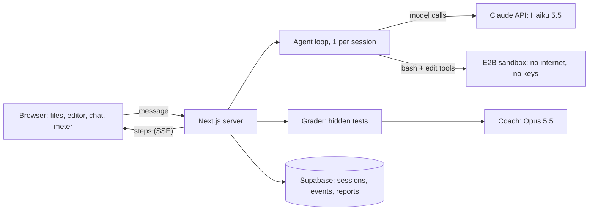

# Brieflab

A practice site for guiding AI coding agents. You brief an agent on a real coding task. A live meter counts every token. Hidden tests grade the result. A coach shows where your tokens went and how to brief better.

## How it works

- The agent loop runs on the server. Only tools run in the sandbox, so API keys never enter it.
- Every model call is metered: input, cache write, cache read and output tokens.
- **Par** is the token count of a good brief: the median of 3 reference runs (`npm run calibrate`).

## Run it

1. `npm install`
2. Copy `.env.example` to `.env` and fill it in (Claude, E2B and Supabase keys).
3. `npm run migrate` creates the tables.
4. `npm run dev`, then open http://localhost:3000.

## Scripts

| Command | What it does |
|---|---|
| `npm run dev` | Web app |
| `npm run check` | Type-check, and check that each challenge's start fails and its solution passes (no API calls) |
| `npm run e2e` | End-to-end test against the running app (about $0.02) |
| `npm run play -- <challenge>` | Play a challenge in the terminal |
| `npm run calibrate -- [challenge]` | The 2× rule: 3 good + 3 lazy runs, writes `par.json` |
| `npm run migrate` | Applies `supabase/migrations/*.sql` |

## Add a challenge

Create `challenges/<slug>/` with `challenge.json`, `statement.md`, `repo/`, `hidden/` and `solution/`. `challenge.json` sets `difficulty` (easy, medium, hard) and `category` (bug-fix, spec, refactor, testing, security). Run `bash scripts/check-challenges.sh <slug>`, then `npm run calibrate -- <slug>`. Ship it only if it passes the 2× rule; otherwise set `"draft": true`.

## Deploy (Railway)

The app needs one always-on Node server: live sessions run for up to 30 minutes and stay in memory.

1. In Railway, create a project from this GitHub repo. Railway runs `npm run build` and `npm start`. Node comes from `engines` (22.18 or later).
2. Add the variables from `.env.example`. Set `SITE_URL` to the public URL, for example `https://brieflab.up.railway.app`. `DATABASE_URL` is not needed at runtime.
3. Use a separate E2B key for production. On start and every 5 minutes, the server closes sessions that stopped sending heartbeats, and kills its sandboxes (tagged with its `SITE_URL`) that have no active session.
4. Set the health check path to `/api/health`.
5. In Supabase → Authentication → URL Configuration, add `<SITE_URL>/auth/callback` to the redirect URLs, and set the Site URL to `SITE_URL`.
6. In the GitHub OAuth app, set the homepage URL to `SITE_URL`. The callback URL stays the Supabase one.
7. Deploy outside busy hours: a redeploy ends live sessions. The new server marks them as errors (they do not count) and kills their sandboxes.
