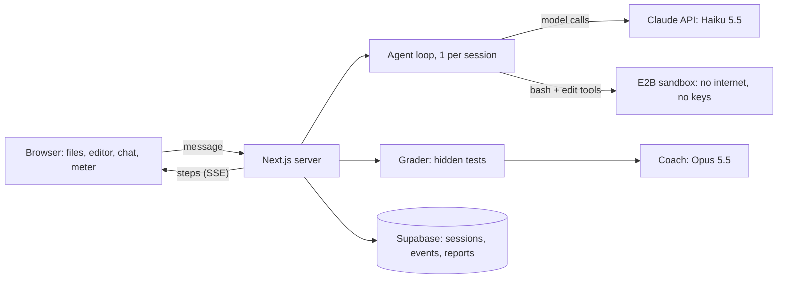

# Brieflab

A practice site for guiding AI coding agents. You brief an agent on a real coding task. A live meter counts every token. Hidden tests grade the result. A coach shows where your tokens went and how to brief better.

## How it works



- The agent loop runs on the server. Only tools run in the sandbox, so API keys never enter it.
- Every model call is metered: input, cache write, cache read and output tokens.
- **Par** is the token count of a good brief: the median of 3 reference runs (`npm run calibrate`).

## Run it

1. `npm install`
2. Copy `.env.example` to `.env` and fill it in (Claude, E2B and Supabase keys).
3. `npm run migrate` creates the tables.
4. `npm run dev`, then open http://localhost:3000.

## Scripts

| Command | What it does |
|---|---|
| `npm run dev` | Web app |
| `npm run check` | Type-check, and check that each challenge's start fails and its solution passes (no API calls) |
| `npm run e2e` | End-to-end test against the running app (about $0.02) |
| `npm run play -- <challenge>` | Play a challenge in the terminal |
| `npm run calibrate -- [challenge]` | The 2× rule: 3 good + 3 lazy runs, writes `par.json` |
| `npm run migrate` | Applies `supabase/migrations/*.sql` |

## Add a challenge

Create `challenges/<slug>/` with `challenge.json`, `statement.md`, `repo/`, `hidden/` and `solution/`. `challenge.json` sets `difficulty` (easy, medium, hard) and `category` (bug-fix, spec, refactor, testing, security). Run `bash scripts/check-challenges.sh <slug>`, then `npm run calibrate -- <slug>`. Ship it only if it passes the 2× rule; otherwise set `"draft": true`.

## Deploy (Railway)

The app needs **one** always-on Node server: live sessions run for up to 30 minutes and stay in memory. `railway.json` pins 1 replica, the health check (`/api/health`) and restarts on failure.

### 1. Production services (separate from dev)

| Service | Do this |
|---|---|
| Supabase | Create a new project for production. Run `DATABASE_URL=<prod session pooler URI> npm run migrate`. |
| Supabase Auth | Turn on GitHub. **Turn off Email**: production signs in with GitHub only (`npm run e2e` needs Email, so run it against dev). |
| GitHub OAuth app | Create a second app for production. Homepage: `SITE_URL`. Callback: `https://<prod-ref>.supabase.co/auth/v1/callback`. |
| Supabase URLs | Site URL: `SITE_URL`. Redirect URLs: `<SITE_URL>/auth/callback`. |
| E2B | Create a separate API key for production. |
| Claude API | Use a separate key. If your Console offers a spend limit, set it as a backstop for `DAILY_SPEND_LIMIT_USD`. |

### 2. Railway

1. Create a project from this GitHub repo. Railway runs `npm run build` and `npm start`. Node comes from `engines` (22.18 or later).
2. Add the variables below.
3. Generate a public domain. Set `SITE_URL` to it, then redeploy.

| Variable | Value |
|---|---|
| `ANTHROPIC_API_KEY` | production Claude key |
| `E2B_API_KEY` | production E2B key |
| `NEXT_PUBLIC_SUPABASE_URL` | `https://<prod-ref>.supabase.co` |
| `NEXT_PUBLIC_SUPABASE_PUBLISHABLE_KEY` | prod publishable key |
| `SUPABASE_SECRET_KEY` | prod secret key |
| `SITE_URL` | the public URL, no trailing slash |
| `ADMIN_GITHUB_IDS` | your GitHub id (`gh api user --jq .id`) |
| `DAILY_SPEND_LIMIT_USD` | `20` |
| `NEXT_PUBLIC_POSTHOG_KEY` | optional |

`DATABASE_URL` is not needed at runtime. Note: `NEXT_PUBLIC_*` values are baked in at build time, so redeploy after you change them.

### 3. Check the deploy

```bash
curl -s $SITE_URL/api/health                    # {"ok":true,"liveSessions":0}
curl -sI $SITE_URL/ | grep -i strict-transport   # HSTS present
curl -si $SITE_URL/auth/login | grep -i location # redirects to <prod-ref>.supabase.co
```

Then sign in with GitHub, play one challenge, submit it and read the debrief. Open the browser console once and look for blocked requests (CSP).

### Operations

- Deploy outside busy hours: a redeploy ends live sessions. The new server marks them as errors (they do not count) and kills their sandboxes. This is safe even when Railway briefly runs the old and the new server together.
- On start and every 5 minutes, the server closes sessions that stopped sending heartbeats, and kills its sandboxes (tagged with its `SITE_URL`) that have no active session.
- Approve beta users in Supabase → Table editor → `profiles` → `approved`.
